# Floor Plan

A self-hosted web app for measuring and documenting your house. Type in the walls you measured with a laser meter and get a to-scale floor plan, then add doors and windows, furniture, the electrical installation, pipes, finishes and renovation plans. It runs on your phone (installable, works offline) and on a desktop.

**[Try the demo](https://lieven121.github.io/floorplan/)** and tap *Try the demo house*. The demo runs without the server, so plans stay in your browser.

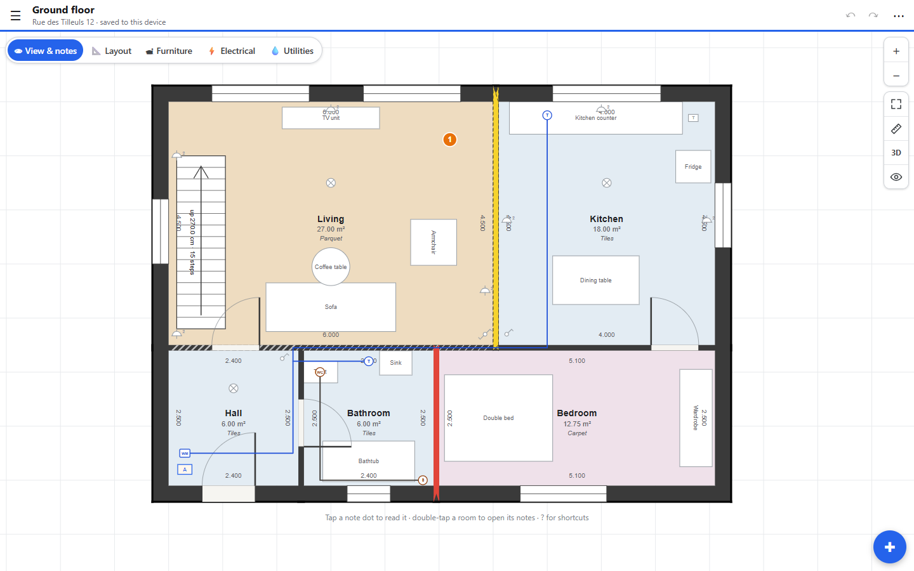

## Features

### Measuring and drawing
- **Rooms from walls.** Go round the room clockwise and type each wall's length. Corners are 90° until you type an angle (a corner that sticks into the room is 270°).
- **Measurements never add up exactly.** The app spreads the error over the walls and shows how far off each one was. Diagonals (corner to corner) let it find the real corner angles.
- **Rooms into a floor.** Drag a room next to another one: it snaps to the shared wall and keeps the wall thickness between them. Turn rooms, line them up with a wall, lock them in place.
- **Doors, windows and openings**, placed by their distance from either corner, with the frame thickness and whether the size you measured includes the frame. Hinged doors with the way they swing, or sliding (glass) doors. Drag them along the wall.
- **Several floors**, with the floor below or above drawn through as an outline.
- **Wall heights, floor levels, stairs and slopes** (ramps), going up or down. In 3D, stairs are just the steps, or solid if you tick it.
- **Chimneys, columns, ducts and masonry blocks:** solid parts of the building in a room, drawn like walls and up to the ceiling in 3D.
- **Sloped ceilings** for attic rooms: knee wall height and roof pitch per wall. The plan shows the line where the free height drops below the usable headroom (1.80 m by default, adjustable), and the usable floor area.
- **Measuring tape** on the floor view for distances and areas.

| Room editor | Attic with sloped ceilings |
|---|---|
| 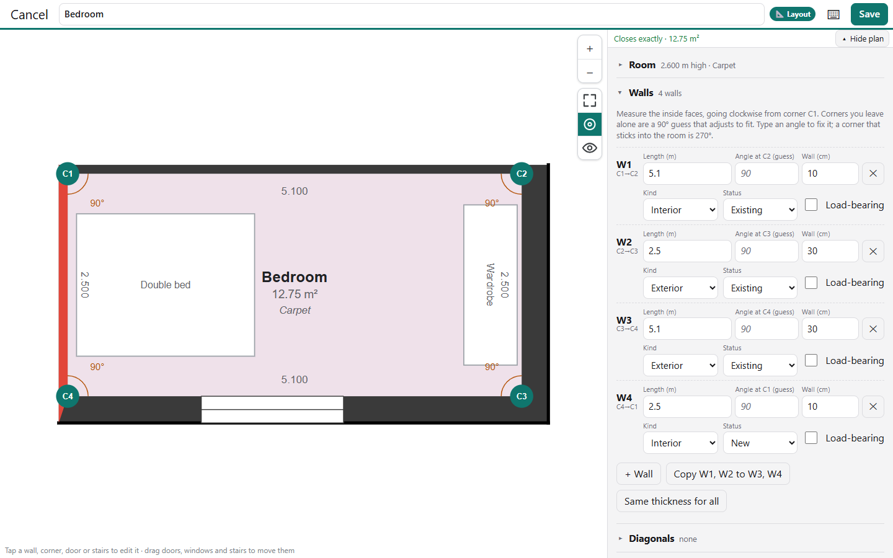 | 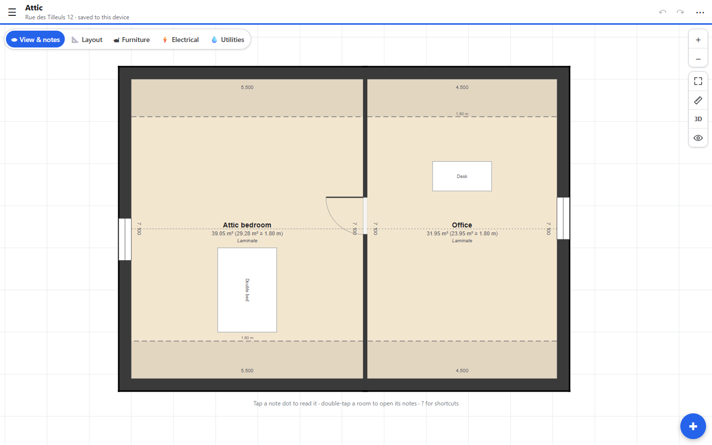 |

### Renovation
- **Room finishes:** floor covering (tiles, laminate, parquet, vinyl, carpet, concrete, screed, or your own text), wall and ceiling finish, and whether the room has skirting boards. The plan can tint rooms by their floor covering.
- **Wall types:** exterior or interior, load-bearing, and existing / new / to demolish. New walls are drawn red and walls to demolish yellow and dashed (the usual Belgian convention), load-bearing walls are hatched. Exports get a legend. A wall between two rooms can be set on both sides at once. Where a wall changes type halfway, split it with a straight 180° corner; remove the corner to join it again.
- **Versions:** save the plan as a named version ("Current", "After renovation"), look at an older version read-only, restore it (the current state is kept as an automatic version first), or start a separate plan from it.

| Versions | Looking at an older version |
|---|---|
| 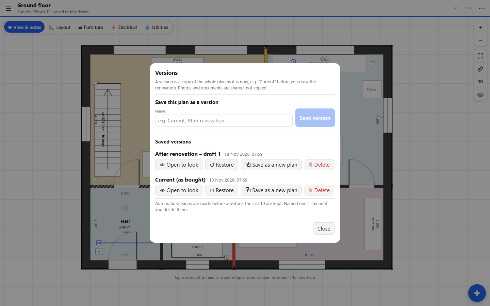 | 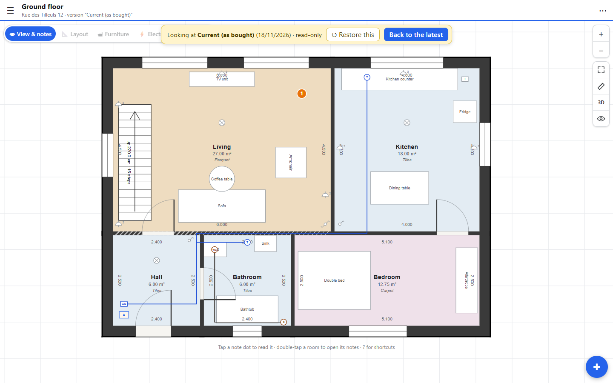 |

### Quantities
Per room and per floor: floor area, usable area, perimeter, skirting length (minus doors), wall area gross and net (minus doors and windows, following sloped ceilings), ceiling area (sloped parts at their real size), and doors and windows. Also floor area per covering, length and area of new walls and walls to demolish, metres of pipe and the number of electrical points. Save it as a spreadsheet (CSV that opens directly in Excel or LibreOffice with Belgian settings: `;` and decimal comma).

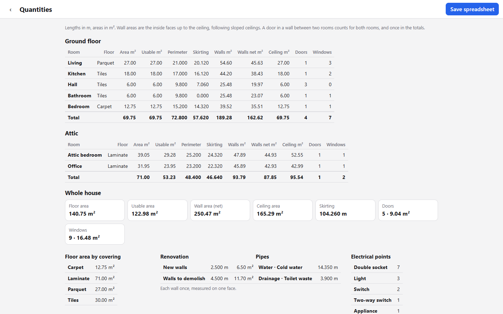

### 3D
The house in 3D: walls with their door and window openings, sloped ceilings, stairs, furniture, floor coverings and the renovation colours. One floor or the whole house; ceilings hidden, see-through or solid. Save it as a picture.

| Ground floor | Whole house |
|---|---|
| 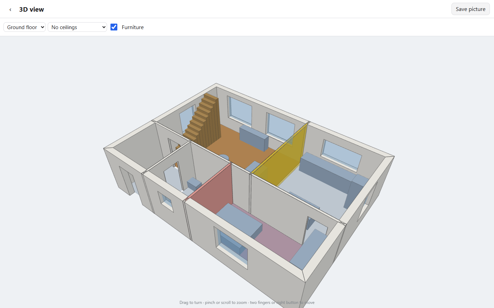 | 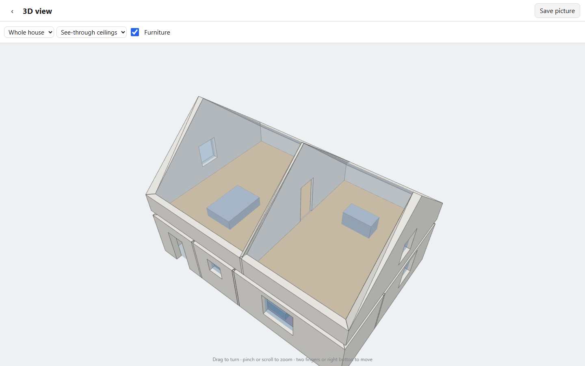 |

### Installations
- **Electrical:** sockets, lights, switches (linked to the lights they control), appliances and fuse boxes on the plan (the *situatieschema*). Fuse boxes with circuits and breakers, the single-line diagram (*eendraadschema*) as SVG or PDF, and a check against the main rules of the Belgian AREI.
- **Utilities:** water, drainage, heating, ventilation and gas: points (taps, meters, drains, radiators, …) and pipe runs, with their lengths.

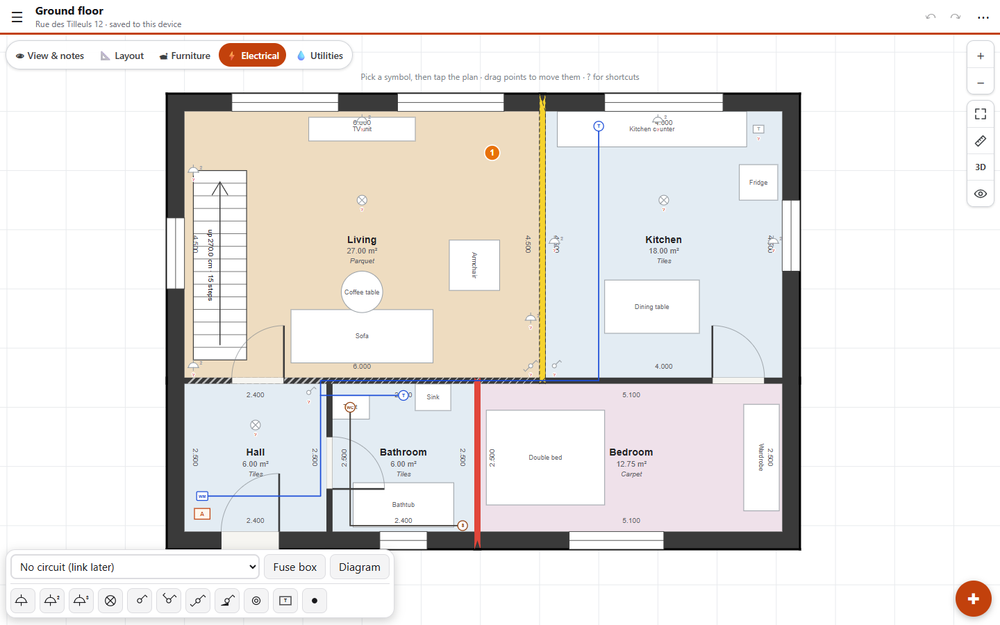

### Notes, furniture and export
- **Notes and photos:** numbered note dots anywhere in a room, each with text, photos and documents (photos need the server).
- **Furniture** from a list of common sizes, dragged and turned in the room, with its height and how high above the floor it hangs (wall cupboards and shelves are dashed on the plan). While you drag, a piece lines up with the walls and with the edges and centres of other pieces (Ctrl: free, Shift: in a straight line); hold Alt to see its distance to the walls and furniture around it. Give pieces a colour, and put them in a group (a table and its chairs) to move and turn them together.
- **Lining up electrical and utility points:** a dragged socket, switch, tap or radiator snaps onto a nearby wall and lines up with other points and room corners (Ctrl: free, Shift: in a straight line, Alt: distances to the walls).
- **Copy and paste** furniture, doors, windows and electrical points (Ctrl+C, Ctrl+V, Ctrl+D or the duplicate button), also into another room or floor, and put the lists in your own order.
- **Undo and redo** in the room editor (Ctrl+Z, Ctrl+Y), back to when you opened the room; Escape while dragging puts a piece back.
- **Export:** PDF to scale (1:50, 1:100, … on A4 or A3, with a scale bar to check with a ruler), PNG, JPG, SVG, and the whole project as one JSON file (with the photos) to import again later. Choose what each export shows.
- **Keyboard shortcuts** on a desktop (press `?`), undo and redo.

| Export | On a phone |
|---|---|
| 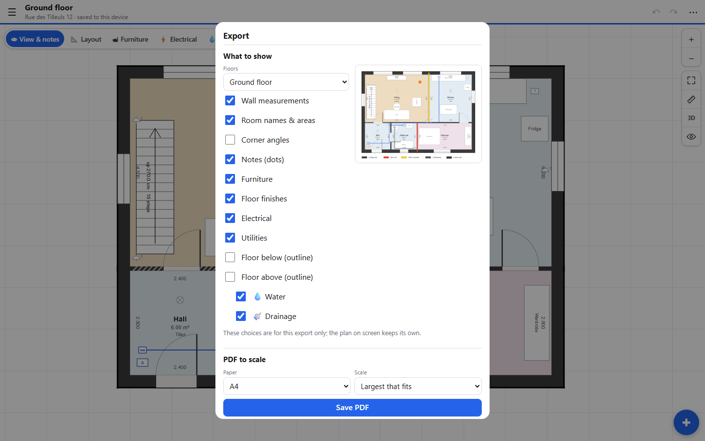 | 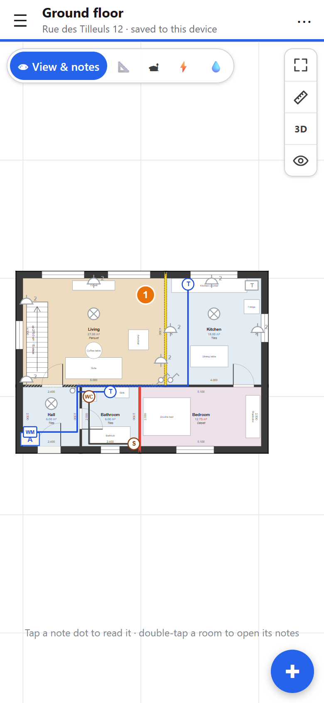 |

### Where plans are kept
- **On the device:** without an account, plans are saved in the browser (IndexedDB). Export the project file to keep a backup.
- **On your server:** sign in with your own OIDC provider (Authentik, Keycloak, …) and plans, versions, photos and documents are saved on the server. Share a plan with someone by email as viewer or editor. Plans on the device can be uploaded to the account.

## Running it

### Docker (app and server in one container)

One image holds the PWA and the ASP.NET Core API. It is published as `ghcr.io/lieven121/floorplan` for amd64 and arm64 (a Raspberry Pi works). You need an OIDC provider (Authentik, Keycloak, …) with this client:

- **Type:** public (no secret), Authorization Code with PKCE
- **Redirect URI:** the app's address with the trailing slash, e.g. `https://floorplan.example.com/`
- **Post-logout redirect URI:** the same address
- **Web origin:** `https://floorplan.example.com`
- **Scopes:** `openid profile email` (add `offline_access` on Authentik to stay signed in)

The provider walkthroughs are in [server/README.md](server/README.md#oidc-provider).

Put this in a `docker-compose.yml`, fill in your provider, and run `docker compose up -d`:

```yaml
services:
  floorplan:
    image: ghcr.io/lieven121/floorplan:0.9   # or :latest, or an exact version like :0.9.0
    restart: unless-stopped
    ports:
      - "8080:8080"
    volumes:
      - floorplan-data:/data
    environment:
      Oidc__Authority: https://auth.example.com/application/o/floorplan/
      Oidc__ClientId: floorplan
      # Oidc__Scopes: openid profile email offline_access   # on Authentik
      # Oidc__Audience: account                              # on Keycloak without an audience mapper

volumes:
  floorplan-data:
```

To build the image from the source instead, clone the repository and use its `docker-compose.yml`:

```bash
cat > .env <<'ENV'
OIDC_AUTHORITY=https://auth.example.com/application/o/floorplan/
OIDC_CLIENT_ID=floorplan
ENV
docker compose up -d --build
```

The app listens on port 8080 and keeps its data in the `floorplan-data` volume. Put it behind your TLS reverse proxy. See [server/README.md](server/README.md) for the settings, the provider setup and the API.

### Static files only (no accounts)

`npm run build` and serve `dist/` from any static web server with HTTPS (needed to install the app). Plans then stay on each device. For example on Home Assistant: copy `dist/` to `config/www/floorplan/` and open `https://<your-home-assistant>/local/floorplan/`. After an update, reload the page twice.

## Development

Requires Node 22.18+ and, for the server, the .NET 10 SDK.

```bash
npm install
npm run dev        # http://localhost:5173, also reachable from your phone on the LAN
npm test           # unit tests (geometry, file format, quantities, electrical rules)
npm run lint
npm run build      # type-check (vue-tsc) + build → dist/
```

```bash
cd server/Floorplan.Api && dotnet run   # API on http://localhost:5080; the dev server proxies /api to it
cd server && dotnet test
```

In Development the API runs without sign-in; the app offers the test users `dev`, `alice` and `bob` to try sharing.

Stack: Vite+ (`vp`), Vue 3 (Composition API, TypeScript), three.js, jsPDF + svg2pdf.js, vite-plugin-pwa; ASP.NET Core 10, EF Core with SQLite.

## Project layout

| Path | What it does |
| --- | --- |
| `src/model/` | The project file format (`schema.ts`, versioned), import and upgrades (`migrate.ts`), electrical, utilities, furniture, finishes and quantities. |
| `src/geometry/` | Walls → closed outline (least-squares fit with diagonals), rooms on a floor, shared walls, sloped ceilings, measuring. |
| `src/components/` | Vue screens: plan list, floor view, room editor, 3D, quantities, versions, export, fuse boxes. |
| `src/three/house.ts` | Builds the 3D model. |
| `src/electrical/` | Single-line diagram and AREI checks. |
| `src/export/exporters.ts` | PDF, SVG, PNG/JPG and JSON export. |
| `src/storage/` | `StorageAdapter`: IndexedDB on the device, or the REST API. |
| `server/` | ASP.NET Core API: homes, sharing, files, versions. |

The screenshots in `docs/screenshots/` show a made-up demo house.

## License

[MIT](LICENSE)
